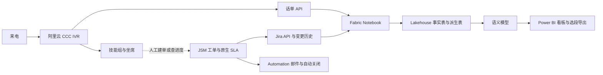
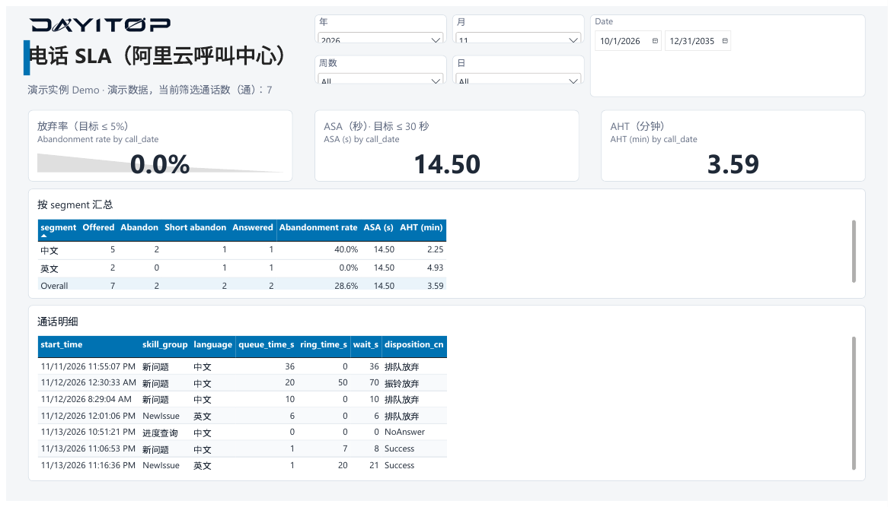
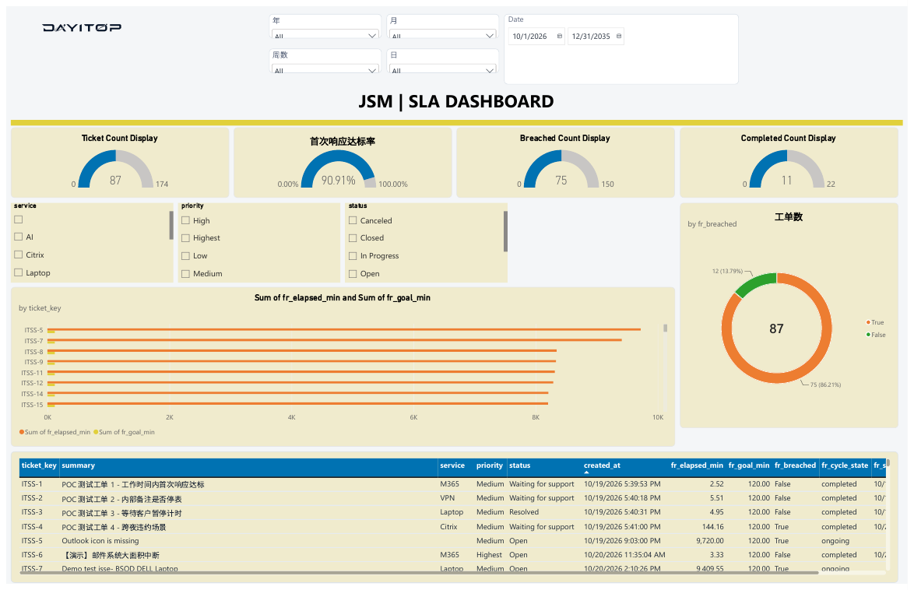
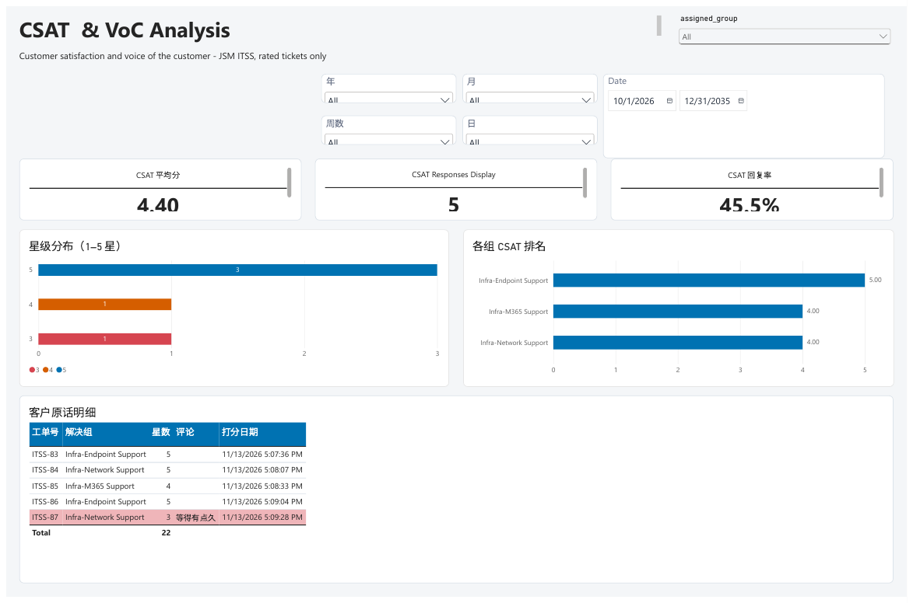

[English version](README_EN.md)

# DAYITOP Service Desk Showcase

一份可公开分享的服务台实战资料：把电话入口、工单 SLA 与生命周期、Fabric 数据分析串成可解释、可验收的流程。适合 IT 服务台负责人、ITSM 实施人员、数据分析师，以及准备演示环境的工程师。

本项目是历史实践的脱敏整理，不是开箱即用的云环境，也不是企业正式 SLA 承诺。仅含文档与通用脚本；不包含真实数据、报表定义、截图、凭据或原始材料。

## 三块内容

| 内容 | 入口 | 核心价值 |
|---|---|---|
| 阿里云云联络中心 | [IVR 搭建](docs/01-aliyun-contact-center/ivr-guide.md)、[电话 SLA 与刷新](docs/01-aliyun-contact-center/telephony-sla-api.md) | 中文四路入口、双语设计、增量发布、话单口径与 API 验数 |
| Jira Service Management | [SLA Showcase](docs/02-jira-jsm/sla-showcase.md)、[Lifecycle Monitor](docs/02-jira-jsm/lifecycle-monitor.md)、[CSAT](docs/02-jira-jsm/csat.md)、[Automation](docs/02-jira-jsm/automation.md) | 以 JSM 为计时权威，跟踪无人认领、闲置、等客户及待关闭 |
| Microsoft Fabric | [CLI 与 PBIR](docs/03-fabric/cli-pbir.md)、[日期模型](docs/03-fabric/date-slicers.md)、[试用与归档](docs/03-fabric/trial-archive.md) | 定义备份与读回、日期筛选、按选段导出、退出试用 |

## 架构

电话与工单是两个数据域，材料没有证明来电与工单已自动关联。技能组转接后由坐席建单或查询；图中的虚线表示人工流程。Fabric 汇总 JSM 官方 SLA，不自行推算其工作时间时钟。

## 怎么用

1. 先读对应指南，确认指标、时区、适用范围及“已验证/待验证”边界。
2. 在自己的隔离演示环境中创建虚构数据；把 `<JIRA_SITE_URL>`、`<ALIYUN_ACCOUNT>`、`<INSTANCE_ID>` 等占位符替换为私有配置。
3. 使用 [脚本说明](scripts/fabric/README.md) 在本地检查定义，再按备份、模型验证、报表修改、读回、端到端验收的顺序操作。
4. 用自己的基线验数；文中数字属于不同日期的演示快照，不能混为同一批数据。

## 注意事项

- 本次整理未联网；平台 API、套餐、权限和到期行为均未重新核实，文中的产品限制是历史观测。
- 中文 IVR 四路曾实拨通过；英文完整流程、错键回路未完成实拨验收。
- 日期切片器已于 2026-11-14 在演示环境上线（Route A：湖仓物理日期列 + DimDate，20 个切片器，浏览器验过）；本文仍保留模型门槛的检查步骤，换环境时先过门槛再部署。
- CSAT 材料只足以支持指标基线与验收方法，不能据此宣称采集链路或邀请机制已完整实现。
- 脚本的 `get` / `update` 会联网；`update` 会修改目标环境。本次仅交付文件并离线验证，未运行任何远端操作。
- 凭据使用环境外的受控秘密存储或平台连接；不要照搬历史上把密钥放入普通配置表的做法。
- 工作目录、导出文件和定义备份可能包含真实数据；必须留在仓库外。`.gitignore` 不能替代公开前复核。

来源与脱敏边界见 [SOURCES.md](docs/SOURCES.md)。代码与文档按 [MIT](LICENSE) 许可发布。

## 报表截图（2026-11-15，阅读视图）

电话 SLA 报表（阿里云呼叫中心）：7 通，放弃率 28.6%，ASA 14.50 秒，AHT 3.59 分钟。顶部放弃率卡片带趋势轴，显示所选日期中最晚一天的值（全选时为 11-13 当天 0.0%）；聚合放弃率以分段表 Overall 行 28.6% 为准。

JSM SLA 看板总览：87 张工单，首次响应达标率 90.91%。

CSAT 与 VoC 分析：平均分 4.40，回复 5 条，回复率 45.5%。
