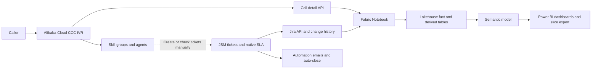
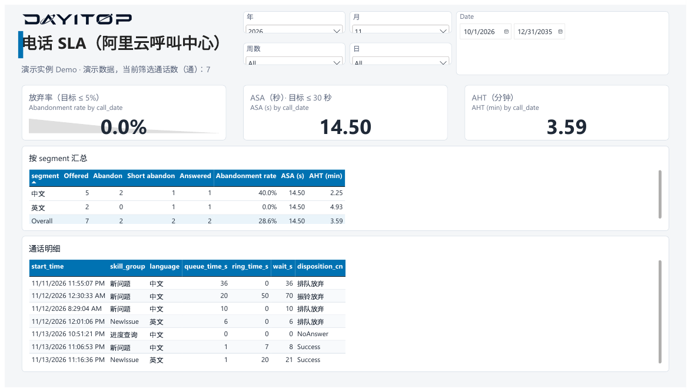
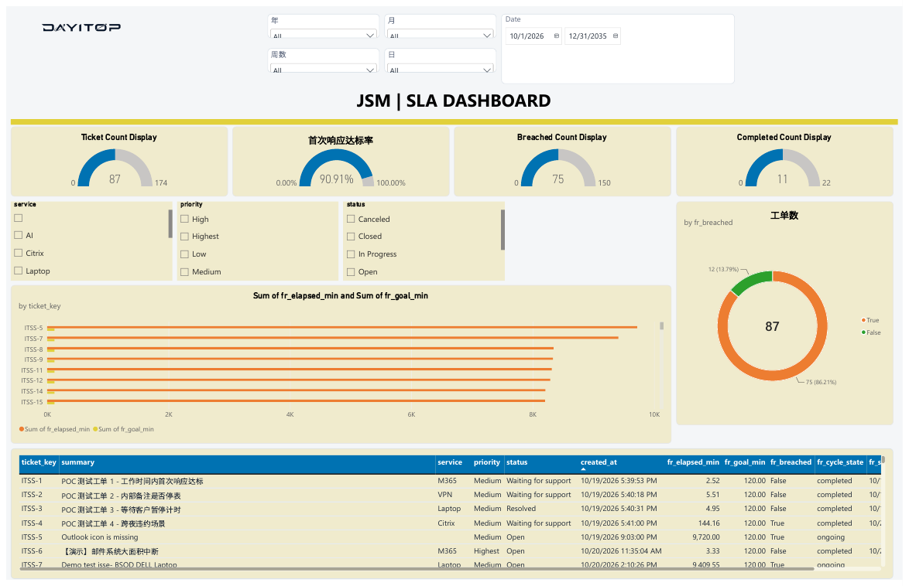
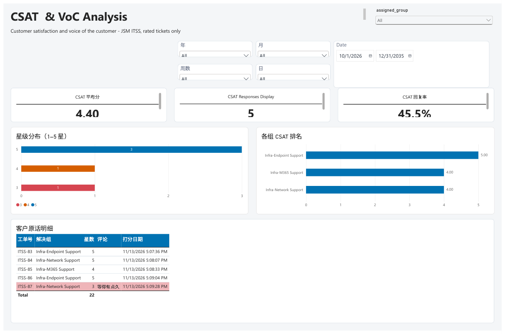

This English version is a translation of the [Chinese version](README.md). The Chinese version is authoritative.

# DAYITOP Service Desk Showcase

A publicly shareable collection of practical service desk documentation connecting telephone intake, ticket SLA and lifecycle management, and Fabric analytics into workflows that can be explained and validated. Intended for IT service desk leads, ITSM implementers, data analysts, and engineers preparing demo environments.

This project is a sanitized compilation of historical practice, not a ready-to-use cloud environment or a formal enterprise SLA commitment. It contains only documentation and generic scripts; it includes no real data, report definitions, screenshots, credentials, or source materials.

## Three Areas

| Area | Guides | Core Value |
|---|---|---|
| Alibaba Cloud Contact Center | [IVR Setup](docs/en/01-aliyun-contact-center/ivr-guide.md), [Telephony SLA and Refresh](docs/en/01-aliyun-contact-center/telephony-sla-api.md) | Four Chinese-language routes, bilingual design, incremental publishing, call record definitions, and API data reconciliation |
| Jira Service Management | [SLA Showcase](docs/en/02-jira-jsm/sla-showcase.md), [Lifecycle Monitor](docs/en/02-jira-jsm/lifecycle-monitor.md), [CSAT](docs/en/02-jira-jsm/csat.md), [Automation](docs/en/02-jira-jsm/automation.md) | Use JSM as the authority for SLA timing; track unassigned tickets, inactivity, waiting for customers, and pending closure |
| Microsoft Fabric | [CLI and PBIR](docs/en/03-fabric/cli-pbir.md), [Date Model](docs/en/03-fabric/date-slicers.md), [Trial and Archiving](docs/en/03-fabric/trial-archive.md) | Definition backups and readback, date filtering, exporting selected subsets, and ending a trial |

## Architecture

Telephone calls and tickets are separate data domains. The materials do not establish that calls and tickets have been linked automatically. After transfer to a skill group, an agent creates a ticket or checks its status; the dotted line in the diagram represents this manual process. Fabric aggregates official JSM SLA results rather than calculating JSM business-time clocks itself.

## How to Use This Project

1. Read the relevant guide first to confirm metric definitions, time zones, scope, and the boundaries between verified and unverified behavior.
2. Create fictional data in your own isolated demo environment. Replace placeholders such as `<JIRA_SITE_URL>`, `<ALIYUN_ACCOUNT>`, and `<INSTANCE_ID>` with private configuration.
3. Use the [script documentation](scripts/fabric/README_EN.md) to inspect definitions locally, then proceed in this order: backup, model validation, report changes, readback, and end-to-end acceptance testing.
4. Reconcile against your own baseline. The figures in these documents are demo snapshots from different dates and must not be treated as a single dataset.

## Notes

- This compilation was prepared without internet access. Platform APIs, plans, permissions, and expiry behavior were not reverified; product limitations described here are historical observations.
- All four Chinese IVR routes passed live-call tests. The complete English flow and invalid-key loop did not complete live-call acceptance testing.
- Date slicers went live in the demo environment on 2026-11-14 (Route A: physical date columns in the Lakehouse + DimDate, 20 slicers, verified in the browser). The model prerequisite checks remain in the documentation; when moving to another environment, pass those checks before deployment.
- The CSAT materials support only metric baselines and acceptance methods. They do not establish that the collection pipeline or invitation mechanism has been fully implemented.
- The scripts' `get` / `update` commands access the network; `update` modifies the target environment. This delivery contains files and offline validation only; no remote operations were run.
- Use controlled secret storage outside the environment or platform connections for credentials. Do not repeat the historical practice of storing keys in ordinary configuration tables.
- Working directories, exports, and definition backups may contain real data and must remain outside the repository. `.gitignore` does not replace a review before publication.

See [SOURCES.md](docs/en/SOURCES.md) for sources and sanitization boundaries. Code and documentation are released under the [MIT](LICENSE) license.

## Screenshots (2026-11-15, reading view)

Telephony SLA report (Alibaba Cloud Contact Center): 7 calls, abandonment rate 28.6%, ASA 14.50 s, AHT 3.59 min. The abandonment-rate card at the top carries a trend axis and shows the value of the latest selected day (0.0% for 11-13 when all dates are selected); the aggregate rate is the Overall row of the segment table, 28.6%.

JSM SLA dashboard overview: 87 tickets, first-response target rate 90.91%.

CSAT and VoC analysis: average score 4.40, 5 responses, response rate 45.5%.
