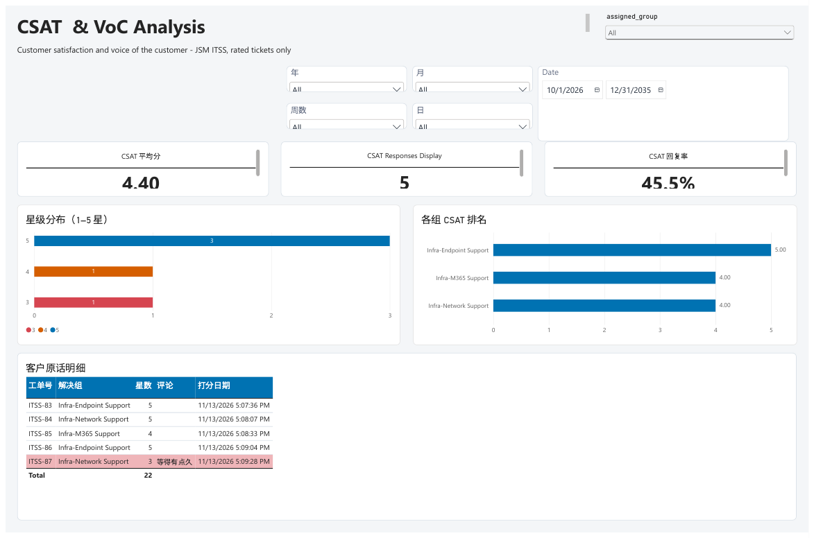

# CSAT 做法：指标、日期与证据缺口

来源：S6。材料提供 CSAT & VoC 页的基线与日期筛选要求，没有提供完整邀请规则、表单配置和采集字段链路。这里给出可复核的做法，不声称采集流程已完整跑通。

## 可保留的基线

| 指标 | 历史展示值 |
|---|---:|
| 平均评分 | 4.40 |
| 回复数 | 5 |
| 回复率 | 45.5% |
| 分母状态集合 | Resolved + Closed，共 11 张 |

该快照回复率为 5/11；不能推广为所有系统的 CSAT 标准分母。材料未给出无效评分、多次回复、重开或取消单的处理规则，应在实际环境补齐后再写正式指标。

## 落地顺序

1. 核对本环境是否启用满意度邀请、何时发送以及谁有资格回复；用虚构单真实走完流程并保存脱敏验证记录。
2. 明确一单一票还是多次反馈，保留评分、回复时间和可空标记。没有回复不能填成零分。
3. 对账“符合分母条件的工单集合”和“已有有效回复集合”，再计算均值和回复率。
4. VoC 文本只处理虚构或经过单独审核的内容；本仓库不收录评论原文或用户身份。

页面默认按工单创建日期筛选，与总览统一；如果改按满意度回复日期，就属于另一项口径，必须单独命名。清除日期筛选后，用同一数据快照核对上述基线；均值与比例不统一套 `COALESCE(..., 0)`。

尚需复核：实际采集字段、邀请触发器、评分量表、分母排除条件，以及日期关系对计数和均值的实际影响。

## 报表截图

2026-11-15 阅读视图：平均分 4.40，回复 5 条，回复率 45.5%。
