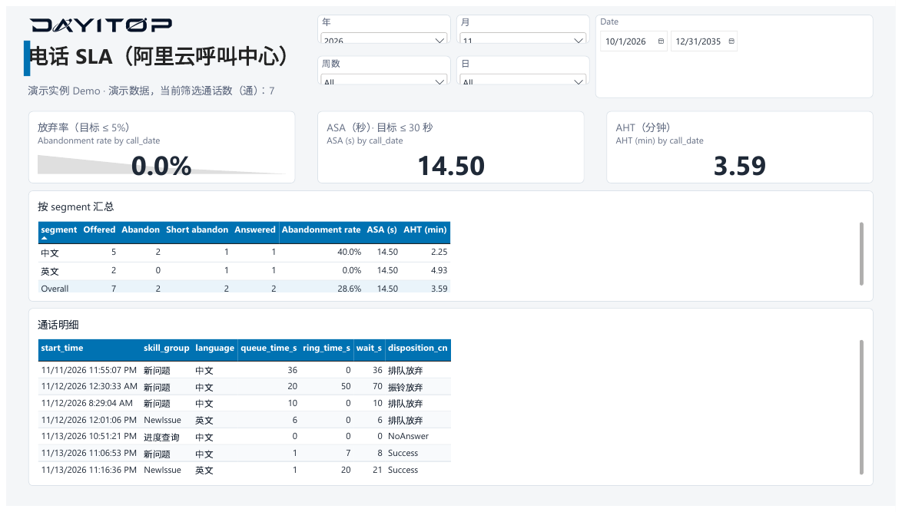

# Telephony SLA Reporting and Automated API Refresh

Source: S3; see S2 for intake context. The API successfully retrieved four records, which were reconciled against a CSV baseline. This document provides no accessible real instance or credentials.

## Data Flow and Tables

```text
Call detail API → Pagination and field mapping → ccc_call_records
                              ↓ Daily aggregation by language/queue
                         ccc_sla_daily → Semantic model → Report
```

Use `<CALL_ID>` as the primary key and deduplicate before loading. Consistently record start and end times; queue, ringing, talk, hold, and wrap-up durations; and queue, language, and status. Use an explicit schema for entirely null columns to avoid inference failures.

## SLA Definitions

| Metric | Definition |
|---|---|
| Offered | Number of incoming calls within the reporting scope |
| Wait | Queue seconds + ringing seconds |
| Abandon | Hang-up during queuing or ringing, with a wait exceeding 30 seconds |
| Short abandon | The same type of hang-up with a wait of no more than 30 seconds; counted separately from abandon |
| Abandonment rate | Abandon / Offered; in this case, the denominator still includes short abandons |
| ASA | Average wait time for answered calls; blank when there are no answered calls |
| AHT | Average handling duration for answered calls; blank when there are no answered calls |

S3 does not provide the full component formula for AHT or a complete threshold/denominator definition for service level attainment. Before adding these measures, agree on whether talk, hold, and wrap-up are included and how short abandons affect the denominator. Abandonment rate must not be treated as the rate of calls answered within target.

## Refresh Procedure

1. Use the private identity `<RAM_USER>` and retrieve credentials through the controlled secret reference `<SECRET_REF>`. The region and `<INSTANCE_ID>` are private configuration.
2. Call `ListCallDetailRecordsV2`. Records are in `Data.List`, and pagination information is in `Data`; retrieve all pages using `TotalCount` and the page number.
3. Parse start and end times as millisecond Unix timestamps. Use a consistent internal time reference and convert to Asia/Shanghai for display, avoiding repeated time-zone conversion.
4. Validate the response structure, pagination completeness, primary-key uniqueness, and types before writing details and daily aggregates.
5. On failure or an unexpectedly empty response, do not overwrite historical tables. Retain refresh status and the last successful refresh time. Distinguish a legitimately empty data window from a parsing failure.
6. Schedule only after successful manual validation. The historical demo refreshed every fifteen minutes. The schedule should end before the services it depends on expire.

Historical practice stored credentials in an ordinary configuration table. This avoided hardcoding in source but was not secure secret management. This project does not copy those configuration tables or temporary notebooks.

## Permission Troubleshooting

At the time, attaching only a RAM read-only policy still resulted in `403` and a missing `CDR:View` permission. An attempted custom Action was unregistered and ineffective. The call worked only after the calling identity was imported into the instance and granted administrator access. This expanded permissions, so the collection could no longer be described as purely read-only.

This describes the permission path in that environment; it is not a default recommendation to grant administrator access. Verify instance roles and least privilege first. If elevated access is necessary, define its scope, duration, and removal steps after the demo.

## Acceptance Baseline: A Separate Four-Call Snapshot

| Segment | Offered | Abandon | Short abandon | Answered | Abandonment Rate |
|---|---:|---:|---:|---:|---:|
| Overall | 4 | 2 | 2 | 0 | 50.0% |
| Chinese | 3 | 2 | 1 | 0 | 66.7% |
| English | 1 | 0 | 1 | 0 | 0.0% |

That run produced four detail rows and five daily aggregate rows; ASA and AHT were blank. Original call primary keys are not public. Compare the primary-key sets, queue/ringing/wait durations, queues, languages, and times record by record. A few differences in region, protocol codes, and IVR seconds did not affect SLA results for this snapshot, but must be recorded.

If the interface succeeds but returns zero rows, first check whether a top-level array was misread. HTTP success is not a substitute for validating storage and reporting. After permissions were fixed, further issues surfaced with entirely null column types, timestamp strings, and missing duration fields in aggregates.

When ending the demo, stop schedules, revoke credentials and additional permissions, and retain the last successful refresh time and sanitized statistics. The historical instance expired before the schedule ended, showing that the two services' lifecycles must be managed together.

## Report Screenshot



Reading view, 2026-11-15: 7 calls, abandonment rate 28.6%, ASA 14.50 s, AHT 3.59 min. The abandonment-rate card at the top carries a trend axis and shows the value of the latest selected day (0.0% for 11-13 when all dates are selected); the aggregate rate is the Overall row of the segment table, 28.6%.
