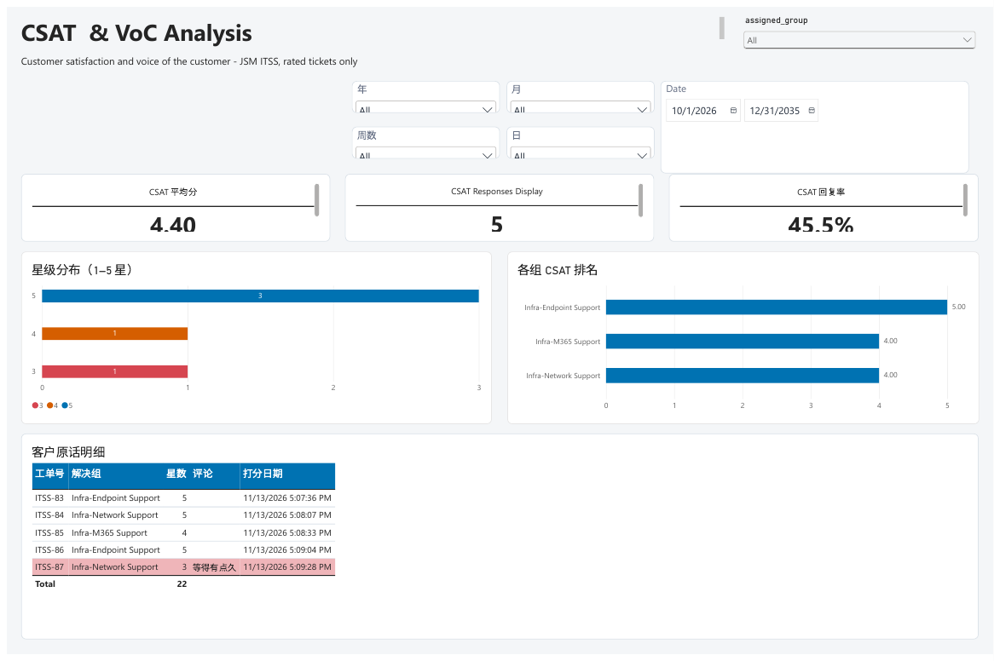

# CSAT Practice: Metrics, Dates, and Evidence Gaps

Source: S6. The materials provide baselines and date-filtering requirements for the CSAT & VoC page, but not complete invitation rules, form configuration, or the collection field pipeline. This document describes an approach that can be checked; it does not claim that the collection process has been fully validated end to end.

## Baseline to Retain

| Metric | Historical Displayed Value |
|---|---:|
| Average rating | 4.40 |
| Responses | 5 |
| Response rate | 45.5% |
| Denominator status set | Resolved + Closed, 11 tickets in total |

The response rate in this snapshot is 5/11. This is not a standard CSAT denominator for every system. The materials do not specify handling rules for invalid ratings, multiple responses, reopened tickets, or canceled tickets. Define these in the actual environment before documenting formal metrics.

## Implementation Sequence

1. Check whether satisfaction invitations are enabled in the environment, when they are sent, and who is eligible to respond. Run fictional tickets through the actual process and retain sanitized validation records.
2. Decide whether each ticket permits one response or multiple feedback submissions. Retain ratings, response times, and nullable flags. Do not fill missing responses with a zero rating.
3. Reconcile the set of tickets eligible for the denominator with the set that has valid responses, then calculate the average and response rate.
4. Process only fictional or separately reviewed VoC text. This repository contains no original comments or user identities.

By default, the page filters by ticket creation date, consistent with the overview. Switching to satisfaction response date defines a different metric basis and requires a separate name. After clearing date filters, verify the baseline above against the same data snapshot. Do not apply `COALESCE(..., 0)` uniformly to averages and rates.

Still to verify: actual collection fields, invitation triggers, rating scale, denominator exclusions, and the actual effect of date relationships on counts and averages.

## Report Screenshot

Reading view, 2026-11-15: average score 4.40, 5 responses, response rate 45.5%.
