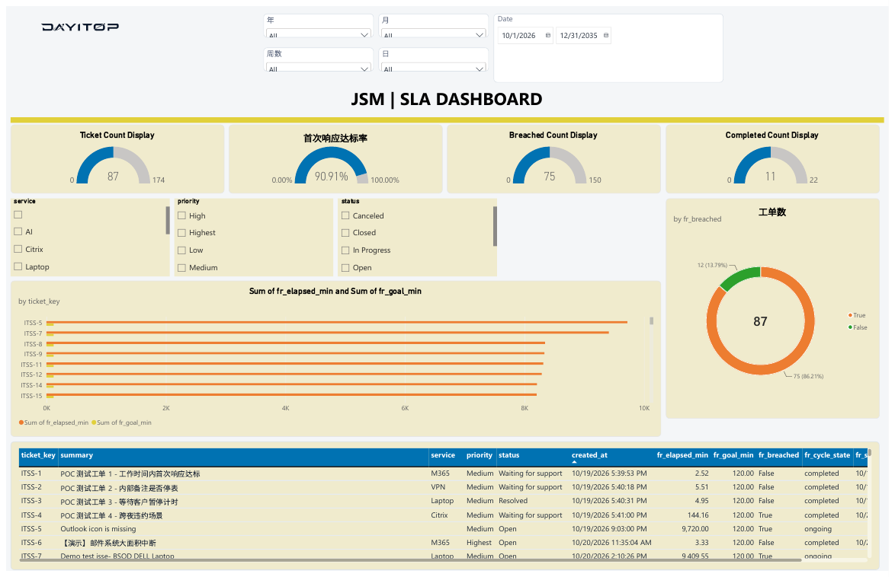

# JSM SLA Showcase: Specification, Retrospective, and Acceptance

Sources: S7 target specification, S4 implementation records, and S6 later baseline. S7 is not evidence of completion; scenarios without evidence remain unverified.

## Demo Boundaries

Use fictional tickets only, with no production mailboxes or customer data. Use `<JIRA_SITE_URL>` for the site and `<ISSUE_KEY>` for tickets. The goal is to let viewers trace “individual ticket events → official JSM cycles → Fabric numerators and denominators,” rather than seeing only a final percentage.

| Configuration | Target |
|---|---|
| SLA | POC - First response, 120 business minutes |
| Start | Requester creates a ticket |
| Stop | First public reply from support; internal notes do not count |
| Pause | While waiting for the requester; resume on leaving that state |
| Business calendar | Asia/Shanghai, Monday to Friday 09:00–18:00, excluding weekends and demo holidays |
| Comparison calendar | POC - 24x7 |
| Reopening | Does not create a second first-response cycle by default; record actual multiple-cycle behavior separately |

Record the Start/Pause/Stop event names shown in the actual interface, goal matching conditions, calendar, and cycle selection. If the version lacks a target condition, document the difference; do not silently substitute resolution time.

## Validation Script

1. Create a fictional ticket and confirm that the real SLA starts.
2. Add an internal note and verify that the clock continues; send a public reply and verify that it actually stops.
3. Verify pausing, resuming, and remaining time while waiting for the requester.
4. Verify a breach scenario. If a shorter goal is used to accelerate the live demo, label it separately rather than presenting it as the 120-minute rule.
5. Show the effect of crossing days and holidays. Friday 17:00 to Monday 10:00 equals 120 business minutes under the calendar above, assuming no additional holidays. This may be a manual calculation for explanation, but must not be presented as execution evidence.

S4 still recorded an unresolved issue in which a public reply did not stop first response, so it is not possible to claim that all stop conditions passed validation.

## Transfer to Fabric

Retain issue key, creation time, status, priority, category, group responsible for resolution, official SLA name/goal/calendar/cycle state/elapsed time/breach status, event times, and export time zone. If CSV lacks cycle or pause information, supplement it from available APIs and mark the source. Never substitute ordinary elapsed time for business minutes.

Use the resolution-responsibility field or a dedicated demo field for the team dimension; do not treat the current assignee as the final resolving team. SLA Rate must document the selected cycle, compliant numerator, comparable-cycle denominator, and null handling, consistently using official JSM results.

## Using Historical Baselines Correctly

- The early fictional Excel comparison used elapsed minutes, with the explicit calculation 95/141 = 67.4%. S7 separately mentions 142 samples, creating a contradiction in the original specification; the calculation was not changed on that basis.
- JSM's 120 business minutes do not inherently equal Excel's 120 elapsed minutes. Do not combine the two sample sets directly.
- S4's lifecycle snapshot contained 82 tickets; S6's later acceptance checklist contained 87. The latter is a pre-change baseline awaiting reconciliation, not a result reverified during this compilation.

Acceptance deliverables should include configuration definitions, actual test events, official SLA results, field mappings, and Fabric figures under the same filter context. Successful ticket creation, a successful rule audit, or a successful report refresh cannot individually substitute for acceptance testing.

## Report Screenshot

Reading view, 2026-11-15: 87 tickets, first-response target rate 90.91%.
